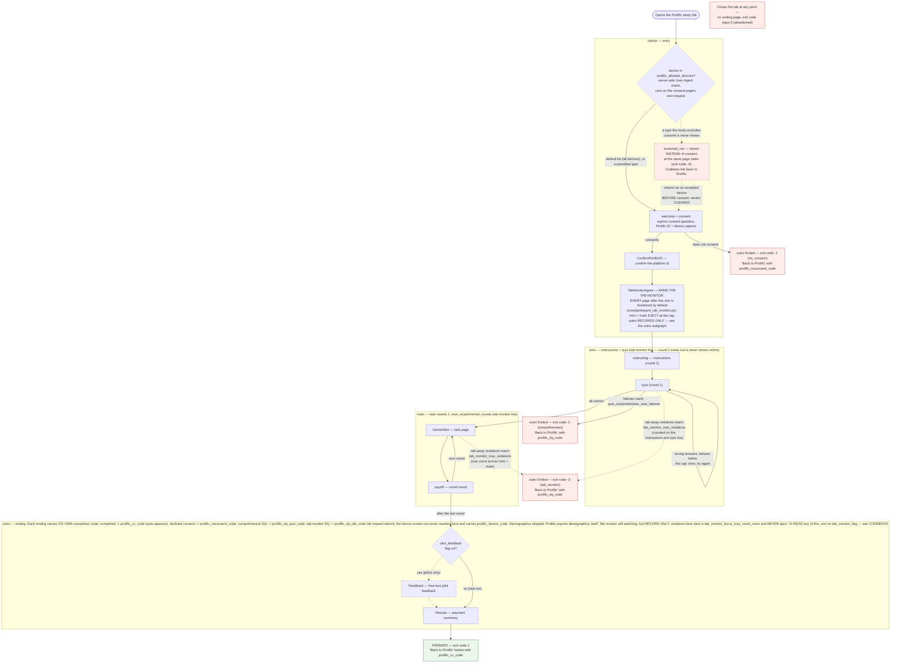
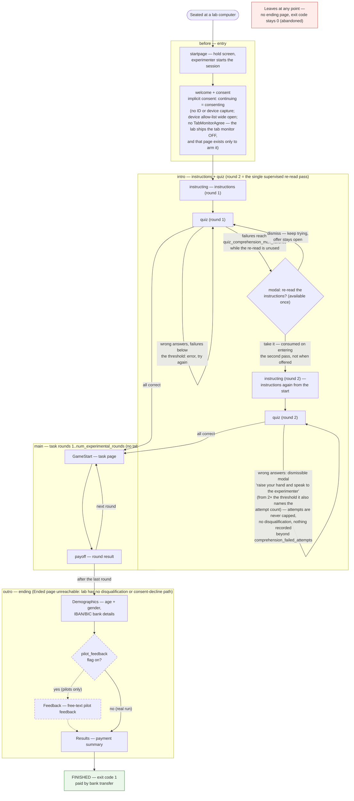

# Participant flow (lab and Prolific)

*Read this when you change the page sequence, endings, completion codes, or anything Prolific-specific.*

## Participant flow by study type

The two charts below are derived from the actual page sequences and
`is_displayed` gates (`before`, `intro`, `main`, `outro`) and the
`settings.EXIT_CODES` table. Dashed nodes/edges are **flag-dependent** (the
pilot feedback page appears only when `pilot_feedback` is on); everything else
is always part of that study type. The charts are laid out identically so the
lab/prolific differences stand out: entry (hold screen vs consent question),
the quiz-failure rule (supervised re-read vs disqualification), the tab
monitor, and the ending (bank details + demographics vs completion codes).

### Prolific

| Exit code | Terminal state | Ending the participant sees | Completion code |
|----------:|----------------|-----------------------------|-----------------|
| `1` finished | Completed the study | `outro` Results → "Back to Prolific" | `prolific_cc_code` |
| `0` abandoned | Closed the tab, never reached the end | none (handled by Prolific as timed-out/returned) | none |
| `-1` no_consent | Declined consent at entry | `outro` Ended → "Back to Prolific" | `prolific_noconsent_code` |
| `-2` comprehension | Failed the quiz `quiz_comprehension_max_failures` times | `outro` Ended → "Back to Prolific" | `prolific_dq_code` |
| `-3` tab_monitor | Tab-away violations reached the cap | `outro` Ended → "Back to Prolific" | `prolific_dq_code` |
| `-4` screened_out | Device stopped by the entry allow-list (only when `prolific_allowed_devices` is narrowed) | `before` screened_out, in place of consent and their FIRST page — a plain link back to Prolific | **none, deliberately** ([why](entry_and_identity.md#the-device-check-what-it-inspects-and-what-it-cannot)) |

> **The table above is the whole table:** every code in `settings.EXIT_CODES` is
> set by real code and appears here (`CODEBOOK.md` names the line that sets
> each). A reserved-but-unwired code is a lie in the export, so it gets deleted
> rather than documented — one such code, `-5`, was removed on those grounds.

### Lab

| Exit code | Terminal state | Ending the participant sees | Completion code |
|----------:|----------------|-----------------------------|-----------------|
| `1` finished | Completed the study | `outro` Results (payment summary; paid by bank transfer) | n/a (no redirects in lab) |
| `0` abandoned | Left the session | none — `comprehension_failed_attempts` and the stage timestamps are the experimenter's record | n/a |

`-1`/`-2`/`-3` cannot occur in lab: consent is implicit, and **the integrity
modules (`quiz_comprehension_dq`, `tab_monitor`) are not supported in a lab session**
— `scripts/prelaunch_check.py` FAILS on a lab config that turns either on. The
reason is conceptual: in the lab, a participant who does not consent or does not
pass the comprehension check simply cannot do the study, and that essentially
never happens because people know what they signed up for when they come to the
lab. The mechanical consequence, which is why it is a hard gate, is that a
disqualified participant is not a completer, so they skip the bank-details page
and the payment summary and are stranded at the machine. The lab's comprehension
rule is the re-read pass plus the "raise your hand" notice; a failed lab
participant is identified at analysis time by
`comprehension_failed_attempts >= quiz_comprehension_max_failures` (see `CODEBOOK.md`).
`-4` cannot occur either unless you narrow `prolific_allowed_devices` on the config — it
permits every device type by default in every profile, and a lab session's
computers would pass anyway.

## Running online on Prolific
Prolific support is **built in** — there is no manual wiring to do. Select the
`prolific` recruitment profile (set `recruitment='prolific'` on your session
config, as the shipped `prolific` config does) and the profile resolves the
relevant feature flags into explicit config keys at import (see the "Parameter
scheme" section and `settings.py`). That bundle turns on:

- **`prolific_capture_participant_id`** — captures the external Prolific participant ID at
  entry (stored in the `participant_id_external` field).
- **`prolific_completion_redirects`** — routes each ending to Prolific with the matching
  completion code: normal completion, declined consent (no-consent) and
  disqualification (comprehension / tab monitor). The entry screen-out is the
  exception: it returns them with NO code, so their submission stays open.
  **Each ending is served ONLY its own code** — a disqualified participant cannot
  read the completion code out of the page source and self-approve. Pinned by
  `scripts/tests/gated_flow_test.py`.

### The five endings and their codes

**Every ending population has its own code.** A shared code collapses two
populations irreversibly on Prolific's side — once a comprehension failure and a
tab-monitor ejection have both submitted under one `DQ-` code, the submission
list cannot tell them apart and nothing downstream recovers it.

| Ending | Config key | Shipped placeholder | Prolific action |
|---|---|---|---|
| Completed | `prolific_cc_code` | `COMP-XXXXXX_REPLACE` | **auto-approve** (this is the one that pays) |
| Declined consent | `prolific_noconsent_code` | `NOCONS-XXXXXX_REPLACE` | request return |
| Comprehension DQ | `prolific_dq_quiz_code` | `DQ-QUIZ-XXXXXX_REPLACE` | request return |
| Tab-monitor DQ | `prolific_dq_tab_code` | `DQ-TAB-XXXXXX_REPLACE` | request return |
| Device screen-out | `prolific_device_code` | `DEVICE-XXXXXX_REPLACE` | request return |

**Only the completed code auto-approves.** The other four are created on Prolific
as **REQUEST_RETURN** codes, each with its own reason text — the API requires
`return_reason` on such a code — so the participant is prompted to return the
submission, which frees the place. That is why the screen-out now carries a code
at all: the bare researcher URL it replaces left the submission in limbo. (This
reverses an earlier decision; see `DECISIONS.md`, both entries.)

Each ending is served **only its own code**, injected per page — never a bundle
in the template context — so a disqualified participant cannot read the completed
code out of the page source and self-approve. Pinned by
`scripts/tests/completion_codes_test.py`, one browser journey per ending.

**Codes are shaped `REASON-XXXXXX`** — a semantic prefix plus six random
alphanumerics (`COMP-K27XQ4`, `NOCONS-T8Q4R1`, `DQ-QUIZ-M4P2W7`): readable in a
Prolific submission list, unguessable by a participant. The template ships them as
`COMP-XXXXXX_REPLACE` / `NOCONS-XXXXXX_REPLACE` / `DQ-XXXXXX_REPLACE`, so the
placeholder itself teaches the convention — and **`scripts/prelaunch_check.py`
refuses to launch while any `REPLACE` survives**, matching by shape rather than by
exact string. The COMPLETION code is the one to guard hardest: on Prolific it can
auto-approve a payment, so keep its random part six or more characters and never
a short number. Full operational detail: `docs/running_on_prolific.md`.
- the **integrity modules** — `tab_monitor`, `quiz_comprehension_dq`, plus
  `telemetry_passive_capture` and `telemetry_device_capture`. With `tab_monitor` on, **every page
  after the agreement screen is monitored by default** (`core/participant_tab_monitor.py` — a
  page can only be unmonitored by opting out explicitly), with one deliberate
  asymmetry: same monitor, same counting, **different consequence by phase**.
  During the instructions, quiz and task, violations count toward
  disqualification (`tab_monitor_focus_loss_count`, ejecting at
  `tab_monitor_max_violations`); during the **outro they are recorded only**
  (`tab_monitor_focus_loss_count_outro`) and never eject — by then the task is over and
  the data collected, so disqualifying somebody who completed the whole study
  (say, for tabbing to Prolific while reading their receipt) would cost a
  real participant for no benefit. A nonzero outro count on a finished
  participant is measurement, not a near-miss.

The profile deliberately does **not** narrow `prolific_allowed_devices` (see the
parameter scheme, [parameters.md](parameters.md)): screening devices out is a separate, explicit decision,
so set e.g. `prolific_allowed_devices=['computer']` on the config if you want it.

**Completion codes** are config values, set in `settings.py`: the
`SESSION_CONFIG_DEFAULTS` placeholders `prolific_cc_code` (normal), `prolific_noconsent_code`
(declined consent) and `prolific_dq_code` (disqualified) — replace the `REPLACE_*`
values, or override them per-config on your `prolific` session config. The
prelaunch check refuses to run online while any code is still a `REPLACE_*`
placeholder. **There are three, not four:** a device screened out at entry gets
a codeless link back to Prolific instead, so its submission stays open — see
[The device check](entry_and_identity.md#the-device-check-what-it-inspects-and-what-it-cannot).

For the operational walkthrough — creating the Prolific study, wiring the URLs,
and the finish-screen routing in practice — see **`docs/running_on_prolific.md`**.
